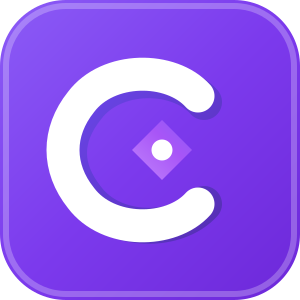
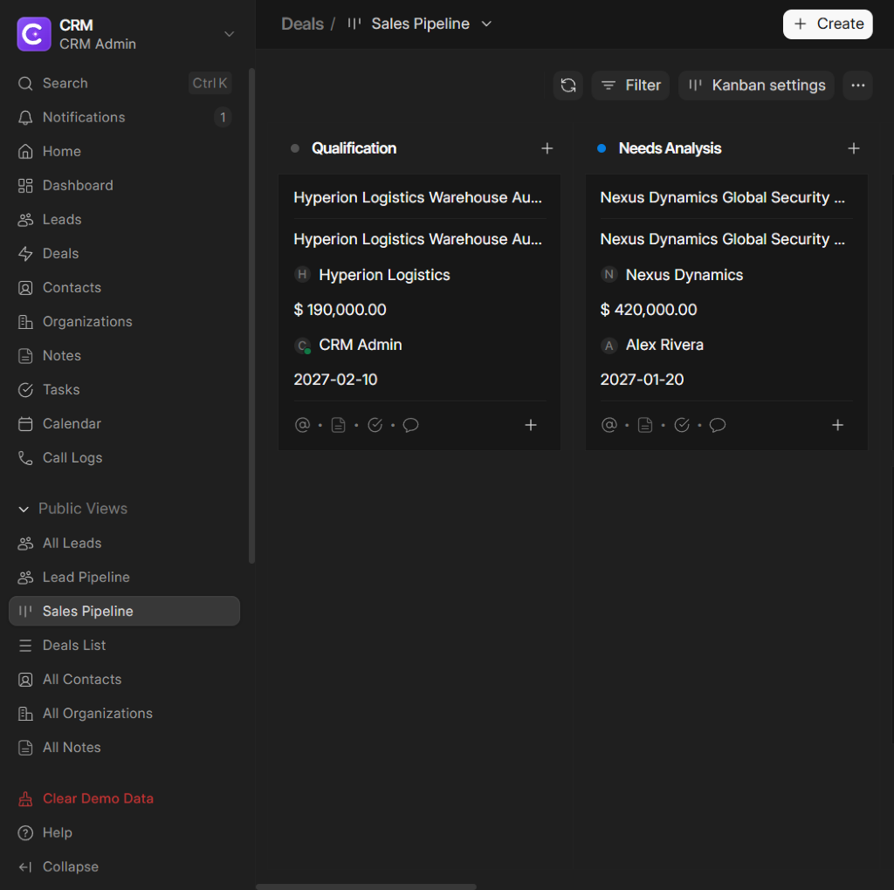
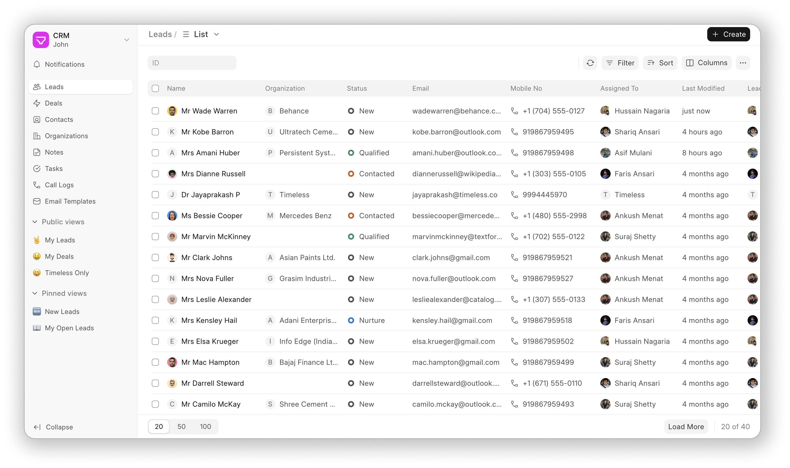
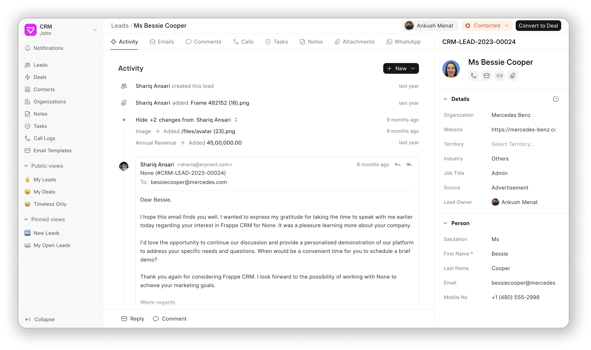
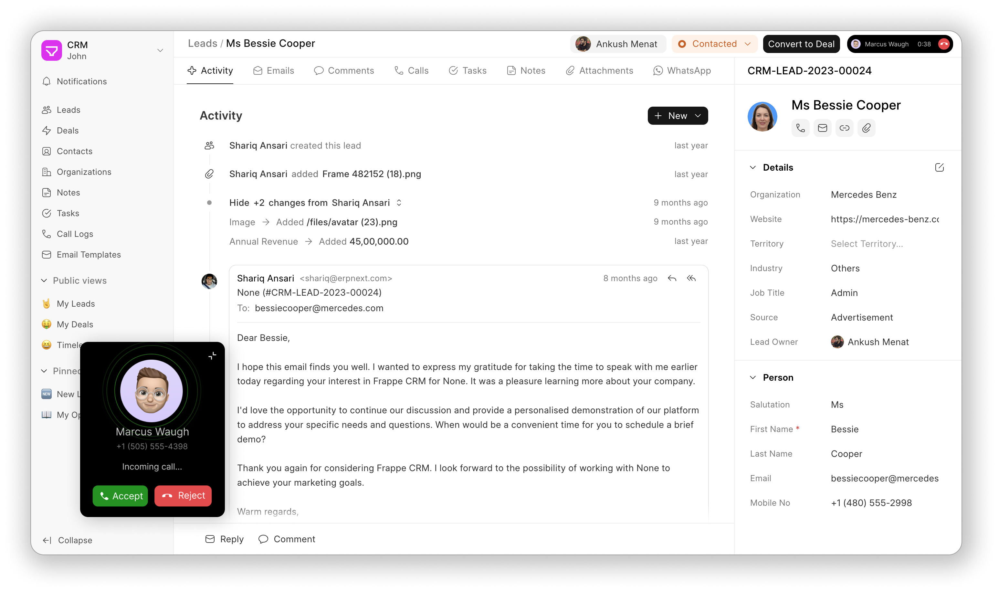
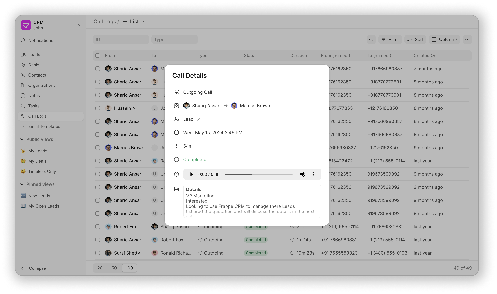

<div align="center">

<a href="https://github.com/Arun-dev-exp/CRM">
  
</a>

# CRM

**Modern Sales Pipeline & Customer Relationship Management**

[](https://github.com/Arun-dev-exp/CRM)
[](https://vuejs.org/)
[](https://vitejs.dev/)
[](https://www.gnu.org/licenses/gpl-3.0)

<br/>

<div>
  <picture>
    
  </picture>
</div>

<br/>

[Features](#key-features) • [Quickstart](#getting-started) • [Testing](#running-tests) • [Architecture](#architecture)

</div>

---

## Overview

**CRM** is a fast, intuitive, and modern customer relationship management platform designed for high-velocity sales teams. Engineered with a responsive Vue 3 single-page interface, it combines deal pipeline tracking, rich contact management, and intelligent interaction timelines to help teams close deals faster without unnecessary complexity.

---

## Key Features

- **Visual Kanban Pipelines**: Drag-and-drop deal management with customizable stages, deal velocity metrics, and revenue totals.
- **Unified Lead & Deal Hub**: Consolidated workspace for leads and opportunities—manage tasks, notes, documents, and communication in one place.
- **Interactive Activity Timeline**: Chronological tracking of meetings, email interactions, notes, follow-up calls, and system events.
- **Custom Views & Smart Filtering**: Build, save, and share filtered views with custom sorting, dynamic queries, and column layouts.
- **Integrated Calling & Communications**: Make and log calls directly from the browser with agent call logs, recording playback, and audio controls.
- **Zero-API Standalone Demo Engine**: Runs out of the box with an in-memory mock engine pre-seeded with realistic leads, deals, contacts, and organizations.

<details>
<summary><b>Click to expand screenshots</b></summary>

<br/>

| Lead Management | Deal Details & Timeline |
|:---:|:---:|
|  |  |

| In-App Calling | Communication History |
|:---:|:---:|
|  |  |

</details>

---

## Getting Started

### Standalone Quickstart (Frontend & Demo Mode)

You can launch and explore the full CRM interface locally in standalone mode with the built-in mock data engine:

```bash
# 1. Clone the repository
git clone https://github.com/Arun-dev-exp/CRM.git
cd CRM/frontend

# 2. Install dependencies
yarn install

# 3. Start development server
yarn dev
```

Open your browser at **`http://localhost:8080`** to start using the CRM with instant mock datasets.

---

## Running Tests

The application includes an extensive unit test suite covering state management, form scripts, layout calculations, and validation logic:

```bash
cd frontend

# Run test suite once
yarn test:run

# Run tests in watch mode
yarn test
```

All 62 test files (549 unit tests) execute and pass in under 15 seconds.

---

## Production Build

To build the production-ready static assets:

```bash
cd frontend
yarn build
```

Compiled assets are bundled and optimized via Vite into `public/frontend`.

---

## Architecture

- **Frontend Core**: [Vue 3](https://vuejs.org/) composition API with `<script setup>`.
- **State Management**: [Pinia](https://pinia.vuejs.org/) reactive stores for caching and optimistic UI updates.
- **Styling & Tokens**: Custom design system tokens with Tailwind CSS utility classes.
- **Testing**: [Vitest](https://vitest.dev/) with Happy-DOM for lightning-fast testing.
- **Standalone Engine**: Built-in mock fetcher providing immediate dev readiness without external backend dependencies.

---

## License

This project is licensed under the [GNU General Public License v3.0](LICENSE).
